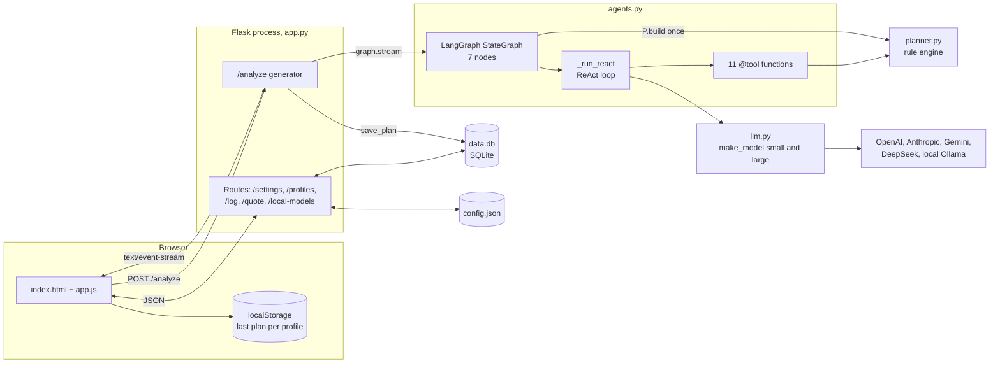
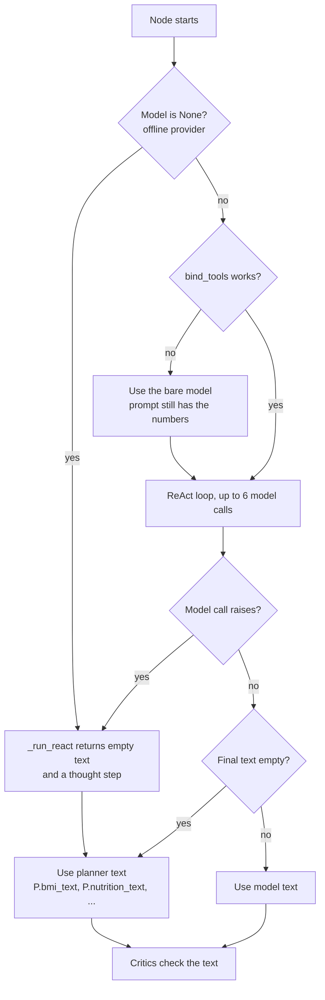
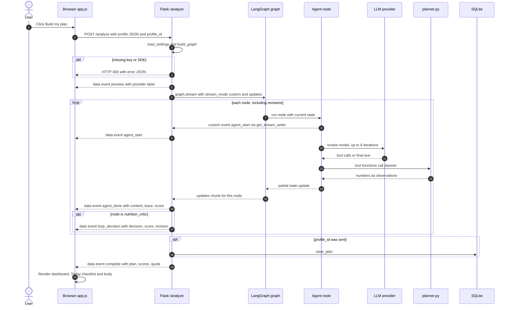
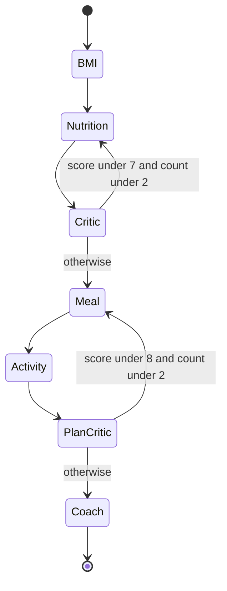
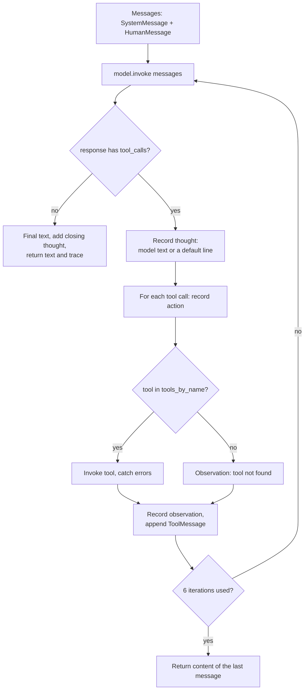

# NutriCoach.AI: overview, system design and workflow

This document explains how NutriCoach.AI is built and how one analysis runs from click to
final report. Every fact here comes from the code in this repo (`agents.py`, `planner.py`,
`llm.py`, `tracker.py`, `app.py`, `desktop.py`, `static/js/app.js`). No performance numbers
were measured, so none are given.

## Contents

- [Overview](#overview)
- [System design](#system-design)
- [Workflow](#workflow)
- [Tech stack](#tech-stack)
- [Trade-offs and what to change at scale](#trade-offs-and-what-to-change-at-scale)
- [Glossary](#glossary)

## Overview

### Problem

Generic diet apps give generic numbers, lean on protein powders and bars, ignore Indian food,
and promise deadlines that are not safe. LLM-only coaches have a different problem: a model can
invent a calorie target or a protein figure, and small local models do this more often.

### What it does

A user fills in a profile (age, sex, height, weight, activity level, target weight and date,
diet type, region, gym yes or no, budget mode, health conditions). Seven LangGraph agents then
produce:

- BMI and risk assessment, using Asian BMI cut-offs when the region is India and WHO cut-offs
  otherwise.
- Three effort paths (Easy, Medium, High), each with calories, steps, gym days, kg per week,
  kg per month, weeks and a deadline date. Weight loss is capped at 1% of body weight a week.
- Macro targets with protein at 1.3 g/kg (0.8 g/kg when kidney disease is listed), from natural
  foods only.
- A 7-day meal plan from a fixed food list, scaled to the calorie target and topped up with
  natural protein, with caps on how often a food repeats.
- A walking plan for everyone and, if opted in, a dumbbell, bench and pull-up bar gym plan.
- Supplements for bone health and recovery only (no protein powders).
- A final coaching report with a safety audit, priorities, milestones and relapse tips.

Around the agents, the app has a daily tracker (calories eaten, steps, gym, healthy eating,
weight), streaks, XP levels, up to 3 profiles and a body illustrator drawn in the browser.

### Who it is for

People in India or Indians abroad who want a realistic plan built from everyday food, and
anyone who wants to run an AI coach on their own machine. It works with a paid API, a free
local model through Ollama, or no model at all.

## System design

### Components and responsibilities

| Component | File | Responsibility |
|---|---|---|
| Single-page UI | `templates/index.html`, `static/js/app.js`, `static/css/app.css`, `static/js/art.js` | Profile form, live agent cards, dashboard, Today checklist, tracker, settings, body illustrator. Reads the SSE stream with `fetch` and a `ReadableStream` reader. |
| Flask API | `app.py` | Settings, profiles, daily log and quote endpoints. `/analyze` builds the graph and streams it as server-sent events. |
| Agent graph | `agents.py` | `NutritionState`, the 7 nodes, the 11 `@tool` functions, the ReAct loop, the two routing functions and `build_graph(cfg)`. |
| Rule engine | `planner.py` | Every number: metrics, paths, targets, meals, supplements, activity, plan checks, score, and the fallback text for each section. |
| Provider layer | `llm.py` | `PROVIDERS`, the small and large tiers, `make_model(cfg, tier)`, the Ollama model list. |
| Tracker | `tracker.py` | SQLite profiles and daily log, day result, streaks, XP levels, quotes. |
| Desktop launcher | `desktop.py` | Runs the Flask app on a free local port and opens it in a chromeless Edge or Chrome window. |

### Architecture



### Nodes

| Node key | UI name | Tools | Model tier | Writes to state |
|---|---|---|---|---|
| `bmi_agent` | BMI Agent | `calculate_bmi`, `classify_risk` | small | `plan` (from `P.build`), `bmi`, `bmi_category`, `tdee`, `risk_level`, `bmi_report`, `bmi_trace`, resets nutrition loop counters |
| `nutrition_agent` | Nutrition Agent | `compute_tdee`, `build_macro_targets` | small | `nutrition_plan`, `nutrition_trace` |
| `nutrition_critic` | Critic Agent | `score_plan` | large | `nutrition_critique`, `nutrition_score`, `nutrition_revision_count`, `critic_trace` |
| `meal_agent` | Meal Agent | `build_meal_plan`, `get_supplement_stack` | small | `meal_plan`, `supplement_advice`, `meal_trace` |
| `activity_agent` | Activity Agent | `walking_plan`, plus `gym_plan` when the recommended path has gym days | small | `activity_plan`, `activity_trace` |
| `plan_critic` | Plan Critic | none (calls `P.plan_checks` directly) | large | `plan_checks`, `plan_score`, `plan_critique`, `plan_revision_count`, `plan_critic_trace` |
| `coach_agent` | Coach Agent | `safety_check`, `synthesise_report` | large | `final_report`, `coach_trace` |

Six nodes run the ReAct loop with tools bound. The Plan Critic is different: code runs the
checks, and the large model is called once, without tools, only to explain failed checks.

### State schema: `NutritionState`

`NutritionState` is a `TypedDict`. Only `messages` has a reducer (`add_messages`, which
appends); every other key is overwritten by the last node that returns it.
`make_initial_state()` fills every key with a default before the run.

| Field | Type | Set by | Purpose |
|---|---|---|---|
| `age`, `gender`, `weight_kg`, `height_cm` | int, str, float, float | `/analyze` request | Core profile |
| `activity_level`, `goal` | str, str | `/analyze` request | Activity multiplier and stated goal |
| `dietary_restrictions`, `health_conditions` | str, str | `/analyze` request | Free text; conditions drive risk, kidney protein limit and safety checks |
| `target_weight_kg`, `target_weeks` | float, int | `/analyze` request | Target for the paths; 0 weeks means no deadline was given |
| `region`, `diet_type` | str, str | `/analyze` request | `in` or `us`; `veg`, `egg` or `nonveg` |
| `gym`, `gym_days`, `budget`, `waist_cm` | bool, int, bool, float | `/analyze` request | Gym opt-in, budget food mode, waist for waist-to-height ratio |
| `plan` | dict | BMI Agent | Full rule-engine output from `planner.build()`: metrics, paths, targets, meals, supplements, activity, body, checklist |
| `bmi`, `bmi_category`, `tdee` | float, str, int | BMI Agent | Copied from `plan["metrics"]` |
| `risk_level` | str | BMI Agent | `standard` or `intervention`, from `classify_risk` |
| `nutrition_score`, `nutrition_revision_count` | int, int | Critic Agent (reset to 0 by BMI Agent) | Control the first critic loop |
| `plan_checks`, `plan_score`, `plan_revision_count` | list, int, int | Plan Critic | Rule check results and control of the second loop |
| `plan_critique`, `nutrition_critique` | str, str | Plan Critic, Critic Agent | Feedback text fed back into the Meal and Nutrition prompts on a revision |
| `bmi_report`, `nutrition_plan`, `meal_plan`, `supplement_advice`, `activity_plan`, `final_report` | str | Each agent | Section text shown in the UI |
| `bmi_trace`, `nutrition_trace`, `critic_trace`, `meal_trace`, `activity_trace`, `plan_critic_trace`, `coach_trace` | list of dicts | Each agent | ReAct steps: `{"type": "thought" or "action" or "observation", "content", "tool"}` |
| `messages` | `Annotated[Sequence[BaseMessage], add_messages]` | Every node | One short `AIMessage` summary per node, appended |

### Provider layer and the two model tiers

`llm.make_model(cfg, tier)` turns the saved settings into a LangChain chat model. SDKs are
imported inside the function, so a missing package only breaks that provider.

| Provider key | Label | Needs key | Small default | Large default | Client |
|---|---|---|---|---|---|
| `openai` | OpenAI | yes | `gpt-4.1-mini` | `gpt-4.1` | `ChatOpenAI` |
| `anthropic` | Anthropic (Claude) | yes | `claude-haiku-5-5` | `claude-sonnet-5-5` | `ChatAnthropic`, `max_tokens=4096` |
| `google` | Google (Gemini) | yes | `gemini-2.5-flash` | `gemini-2.5-pro` | `ChatGoogleGenerativeAI` |
| `deepseek` | DeepSeek | yes | `deepseek-chat` | `deepseek-chat` | `ChatOpenAI` with `base_url=https://api.deepseek.com` |
| `ollama` | Local LLM (Ollama, free) | no | `llama3.2:3b` | `qwen2.5:7b` | `ChatOllama` at `ollama_url` (default `http://localhost:11434`) |
| `offline` | No AI (rule-based only) | no | none | none | `make_model` returns `None` |

Details from the code:

- All clients use `temperature=0.3`. OpenAI, DeepSeek and Anthropic set `max_retries=2` and
  `timeout=90`; Gemini sets `max_retries=2`.
- The user can type any model id for either tier (`model_small`, `model_large`); otherwise the
  provider default is used.
- Keys are passed to each client directly and never written to `os.environ`. `GET /settings`
  returns keys masked (first 5 and last 4 characters).
- A missing key raises `ValueError` inside `build_graph`, and `/analyze` returns HTTP 400 with
  the message before any streaming starts.
- `/local-models` asks Ollama's `/api/tags` for installed models (2-second timeout) and returns
  a suggested list sorted smallest first.

The tiers follow one idea: small models narrate, large models judge. The narrating nodes (BMI,
Nutrition, Meal, Activity) use the small tier. The judging nodes (Critic, Plan Critic, Coach)
use the large tier. Both models are built once per `/analyze` call in `build_graph`.

### Rule engine first, then the fallback chain

The core rule of the project: code computes, the model narrates. `planner.build(state)` runs
once inside the BMI node and stores the whole plan in `state["plan"]`. Every later prompt
carries the exact numbers through `_profile()`, which appends `P.summary(plan)` as
"COMPUTED NUMBERS (use exactly)". The tools themselves are thin wrappers over planner
functions, so a tool call returns planner numbers, not model guesses.

Some tools take only a few numeric arguments and read the rest of the profile from a
module-level dict, `_CTX`, which nodes update before running. The code comment says this keeps
tool calling reliable on small local models.

When something goes wrong, each step falls back to the next:



Inside the loop, a tool that raises returns `Tool error: ...` as its observation, and an
unknown tool name returns `Tool '<name>' not found.`, so the model sees the problem instead of
the run stopping.

The two critics then check the text in code:

- **Critic Agent.** Reads `overall_score` from the `score_plan` observation (JSON parse, then a
  regex), defaulting to 7. Code then checks the nutrition text for banned items (`P.BANNED`),
  the exact daily kcal and the exact protein grams. Each failed check lowers the score cap by 2
  (`score = min(score, 10 - 2 * issues)`) and is appended as "RULE CHECKS FAILED". If no check
  failed and the model wrote nothing, the score is raised to at least 8.
- **Plan Critic.** Runs `P.plan_checks`: calories within 10% of target on average, protein at
  least 95% of target every day, no banned items, no food over its weekly cap, rate of change at
  most 1% of body weight a week, calories above the floor (1500 male, 1200 female), at least
  6000 steps, and gym at least 2 days a week when gym is on. Score is `10 - 2 * failures`,
  floored at 0. The large model only explains the failures, and only when the score is below 10.

### Persistence

| Store | Location | Contents | Written by |
|---|---|---|---|
| Settings | `~/.nutricoach/config.json` | Provider, per-provider keys, `model_small`, `model_large`, `ollama_url`, theme | `POST /settings` (`save_settings`) |
| Tracker DB | `~/.nutricoach/data.db` | `profiles(id, name, data, plan)` and `logs(profile_id, day, kcal_in, steps, gym, healthy, weight)` with primary key `(profile_id, day)` | `tracker.py` |
| Browser | `localStorage` | Last plan per profile, ticked Today checklist items, selected profile id | `app.js` |
| Desktop window profile | `~/.nutricoach/window-profile` | Browser profile for the app window | `desktop.py` |

Notes:

- At most 3 profiles (`MAX_PROFILES`); a fourth insert raises `ValueError` and the API returns
  400.
- After a run with a `profile_id`, `save_plan` stores only what the tracker needs: targets,
  recommended tier, metrics, checklist and body data.
- Logging a day uses `INSERT OR REPLACE`, so one row per profile per day.
- The day result is computed on read: energy out is BMR x 1.2, plus steps x 0.00057 x weight,
  plus 250 kcal on a gym day. A balance below -150 kcal is a fat loss day, above +150 a fat gain
  day, otherwise a maintenance day.
- Streaks count back from today (or yesterday if today is not logged yet) for walking, healthy
  eating and calorie budget; the gym streak counts weeks with 2 or more sessions. XP is
  10 per logged day plus 5 per streak day plus 20 per gym week, with a new level every 150 XP
  across 6 levels (Rookie to Legend).
- Old configs with a single `api_key` are migrated to `keys.openai` on load.

## Workflow

### One `/analyze` request



How the stream is wired:

- `graph.stream(state, stream_mode=["custom", "updates"])` yields `(mode, chunk)` pairs.
- `custom` chunks come from `get_stream_writer()` inside the node wrapper `_node()`, which
  emits `agent_start` with the agent name, node key and description before the node runs.
- `updates` chunks hold one node's returned fields. `app.py` merges them into a local copy of
  the state and uses `DONE_FIELDS` to pick what goes into that node's `agent_done` event.
- After the `nutrition_critic` update, `app.py` calls `should_revise(state)` itself to emit
  `loop_decision`. There is no `loop_decision` event for the Plan Critic.
- `complete` carries the plan, `plan_score`, `nutrition_score`, the number of nutrition
  revisions (`nutrition_revision_count - 1`) and a quote.
- Any exception during the stream becomes an `error` event with the message and traceback.
- Each event is a `data: <json>` line followed by a blank line. The response sets
  `Cache-Control: no-cache` and `X-Accel-Buffering: no`.
- The browser cannot use `EventSource` because the request is a POST with a JSON body, so
  `app.js` reads `response.body` with a reader and splits on blank lines.

Traces are sent whole in `agent_done`, after a node finishes. The UI shows "Thinking..." on a
started card until then. Tokens are not streamed.

### The two critic-revise loops



The routing functions in `agents.py`:

```python
def should_revise(state):
    if state["nutrition_score"] < 7 and state["nutrition_revision_count"] < 2:
        return "nutrition_agent"
    return "meal_agent"

def should_revise_plan(state):
    if state["plan_score"] < 8 and state["plan_revision_count"] < 2:
        return "meal_agent"
    return "coach_agent"
```

Each critic adds 1 to its counter before routing. A walk through the first loop:

| Pass | Counter after critic | Score | Route |
|---|---|---|---|
| 1st critic pass | 1 | under 7 | back to Nutrition |
| 1st critic pass | 1 | 7 or more | on to Meal |
| 2nd critic pass | 2 | any | on to Meal |

So the Nutrition and Meal agents each run at most twice, and the most nodes one run can visit
is 12. On a revision, the critique text goes back into the agent's prompt (`PREVIOUS CRITIQUE
TO ADDRESS` for Nutrition, `PLAN CRITIC FEEDBACK TO FIX` for Meal). Going back to Meal also
re-runs Activity, because the edge from Meal to Activity is fixed.

### The ReAct loop

`_run_react` wraps `_react_loop`. One iteration is one model call; one call can request several
tools, and all of them run in that iteration.



Trace steps have three types, `thought`, `action` and `observation`, which the UI prints as
`[type · tool] content`, cut to 600 characters each. The cap is `max_iters = 6`. If the cap is
reached while the model is still calling tools, the last message is a `ToolMessage`, so the
returned text is that tool's output; the node uses it as-is because it is not empty.

## Tech stack

| Layer | Choice | Version pinned |
|---|---|---|
| Language | Python 3.13 | — |
| Web | Flask | 3.1.3 |
| Agents | LangGraph, langchain-core | 1.2.18, 1.7.0 |
| Providers | langchain-openai, langchain-anthropic, langchain-google-genai, langchain-ollama | 1.7.3, 1.7.7, 4.4.2, 1.1.0 |
| Storage | SQLite (stdlib `sqlite3`), JSON config | — |
| UI | Plain HTML, CSS and JavaScript, no framework | — |
| Desktop | Werkzeug server + Edge or Chrome `--app` window, PyInstaller one-file exe | — |

### Why LangGraph and not a plain LangChain agent

- The flow is a fixed pipeline with two loops, not one agent picking tools. A `StateGraph`
  makes the order, the conditional edges and the loop caps explicit code (`add_edge`,
  `add_conditional_edges`, `should_revise`).
- Loop counters, scores and section text live in one typed state that every node reads and
  returns. A single agent would keep this in a chat history.
- `graph.stream` with `updates` gives one event per finished node, and `get_stream_writer`
  lets a node announce that it started. That maps directly onto the agent cards in the UI.
- Each node still runs its own small ReAct loop, so tool use stays local to one job with
  2 tools at most.

### Why SSE and not WebSockets

- Data flows one way, server to browser, for one request. SSE is a normal HTTP response, so
  a Flask generator with `stream_with_context` is enough. No socket library or extra server
  is needed.
- The request needs a JSON body, so the UI uses `fetch` with a stream reader rather than
  `EventSource`, which only does GET.
- WebSockets would help if the user could steer a run mid-way (for example approve a step),
  which the app does not do.

### Why Flask and not FastAPI

- The graph and the LangChain clients are called synchronously, and the app is local and
  single-user. Flask with `threaded=True` gives each request its own thread.
- The same `app` object is served by `make_server` in `desktop.py` and bundled by PyInstaller,
  with templates found through `sys._MEIPASS`.
- FastAPI would fit better with async model clients and many concurrent streams, which this
  app does not have today.

### Why SQLite

- One user on one machine, two small tables, no server to install, and it ships with Python.
- The file sits in `~/.nutricoach/`, outside the repo, next to the settings.

### Why Ollama for local models

- Free and private: the profile never leaves the machine.
- `ChatOllama` plugs into the same LangChain interface as the cloud clients, including
  `bind_tools`.
- The `/api/tags` endpoint lets Settings list what is installed, and `LOCAL_MODELS` suggests
  models by download size and RAM, smallest first.
- The rule-engine-first design is what makes small local models usable: the model only has to
  write words around fixed numbers.

## Trade-offs and what to change at scale

| Decision | Benefit today | Cost | At scale |
|---|---|---|---|
| Rule engine computes every number | Correct plans on any model, including none | Model output is mostly narration; the critics mainly check that numbers were copied | Keep it; add more rule checks rather than more model judgement |
| Module-level `_CTX` for tool context | Tools need only a few simple arguments | Shared across threads, so two concurrent `/analyze` runs can mix profiles | Pass context through state or bind it per run in a closure |
| Graph and models built per request | Settings changes apply at once | Rebuild cost on every run | Cache compiled graphs per settings hash |
| Traces sent on `agent_done` | Simple event model | No live step-by-step view; long nodes look idle | Emit each ReAct step through `get_stream_writer` |
| Plan Critic loops back to Meal | Meal text gets a second try | The plan numbers come from `P.build` once, so a re-run only changes the text; number checks give the same result | Feed failed checks back into planner parameters |
| Critic score parsed from text | Works with any provider | Fragile parsing; default 7 if no score is found | Use structured output for scores |
| Two loops capped at one revision each | Bounded run length | A weak model gets one retry only | Make the cap a setting |
| `error` event includes the traceback | Easy local debugging | Leaks internals | Log server-side, send a short message |
| Keys in plain JSON in the home folder | No extra dependency | Anyone with access to the folder can read them | OS keychain |
| SQLite, one connection per call | Zero setup | Not for many users | Postgres with a pool |
| No automated test suite in the repo | — | Regressions caught by hand, using the `offline` provider end to end | Unit tests for `planner.py`, graph tests with a fake model |

Two smaller inconsistencies worth knowing:

- The `calculate_bmi` tool and `_bmi_category` in `agents.py` use WHO cut-offs, while
  `planner.metrics` uses Asian cut-offs for region `in`. The state and UI use the planner
  value, but a BMI Agent trace can show a different category.
- The module docstring in `agents.py` and the `synthesise_report` process note still say
  "5 specialist ReAct agents"; the graph has 7 nodes, 6 of them ReAct agents.

## Glossary

| Term | Meaning here |
|---|---|
| Agent node | One function in the LangGraph graph, listed in `NODES` with a UI name, description and model tier |
| ReAct | Reason and act: the model thinks, calls a tool, reads the result, and repeats until it writes a final answer |
| Trace | The list of `thought`, `action` and `observation` steps a node records for the UI |
| Tool | A Python function decorated with `@tool` that the model can call through `bind_tools` |
| Critic-revise loop | A judging node scores the output and the graph routes back to the producing node when the score is low |
| Rule engine | `planner.py`, which computes every number and writes fallback text |
| Fallback text | `P.<section>_text(plan)`, used when the model is missing, fails or writes nothing |
| Model tier | Small (narrating nodes) or large (judging nodes) |
| Provider | One entry in `llm.PROVIDERS`: OpenAI, Anthropic, Google, DeepSeek, Ollama or offline |
| SSE | Server-sent events: a long HTTP response of `data:` lines the server writes as work progresses |
| `stream_mode` | LangGraph option; `updates` yields each node's returned fields, `custom` yields what nodes write through `get_stream_writer` |
| TDEE | Total daily energy expenditure: BMR (Mifflin-St Jeor) times an activity multiplier |
| BMR | Basal metabolic rate |
| Effort path | Easy, Medium or High plan with its own calories, steps, gym days, rate and deadline |
| Asian cut-offs | BMI 23 for overweight and 25 for obese, used when region is `in`; WHO uses 25 and 30 |
| Banned items | `P.BANNED`: whey, protein powder, protein bar, Greek yogurt and similar, checked by both critics |
| Food cap | `P.CAP`: the most times a key food may appear in a week (6 by default) |
| WHtR | Waist-to-height ratio |
