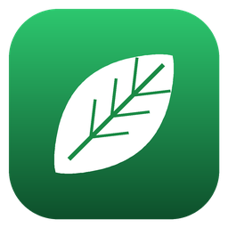
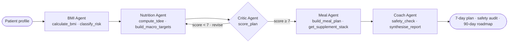
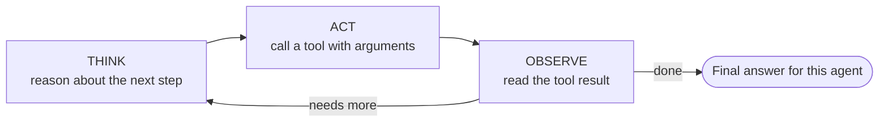
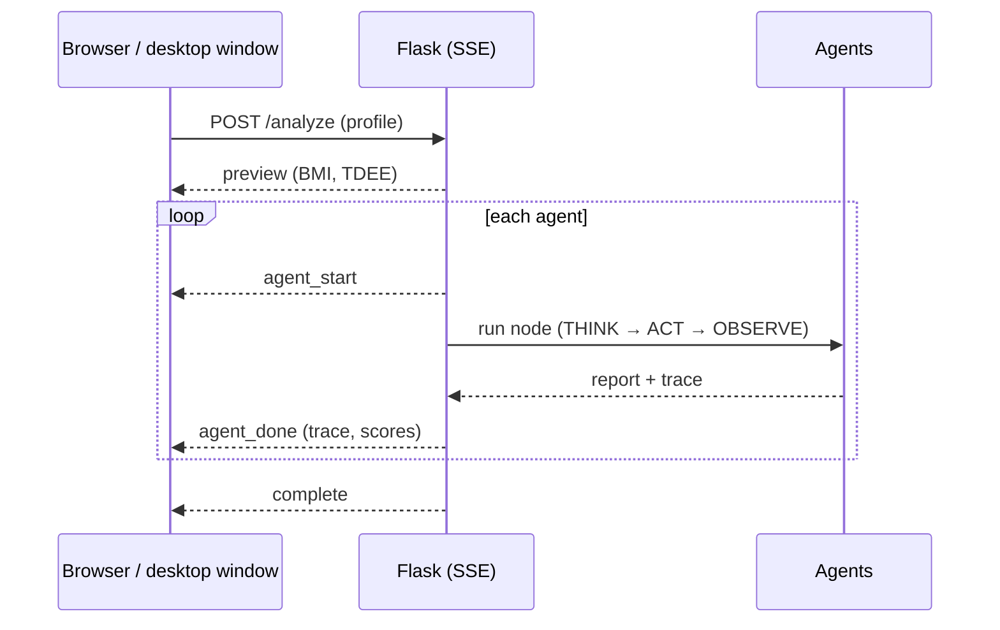

# NutriCoach.AI



A multi-agent clinical nutrition system built with LangGraph where every agent implements the **ReAct (Reasoning + Acting)** pattern — each agent thinks step-by-step, calls tools, observes results, and iterates until it has a complete answer.

---

## Screenshots

### Dashboard — idle state with agent graph


### Meal Agent running — 7-day plan streaming live


### Coach Agent — safety audit result and 90-day coaching report


---

## What is ReAct?

ReAct = **Re**asoning + **Act**ing. Instead of generating a response directly, each agent:

```
THINK   →  decide what tool to call and why
ACT     →  invoke the tool with specific arguments
OBSERVE →  read the tool result
THINK   →  reason about the result, decide next step
...repeat until confident...
ANSWER  →  write final output
```

This is implemented properly — not in name only. The model is bound to tools via `model.bind_tools()`, decides at inference time whether and when to call them, and processes tool results as `ToolMessage` observations fed back into the context window.

---

## How it flows

### Agent graph with the Critic-Revise loop



### Inside every agent: the ReAct loop



### Live streaming to the UI



---

## Architecture

```
                         ┌─────────────────────────────────────────────┐
                         │            LangGraph StateGraph              │
                         └─────────────────────────────────────────────┘

┌──────────────┐    ┌──────────────┐    ┌──────────────┐    ┌──────────────┐    ┌──────────────┐
│  BMI Agent   │───▶│  Nutrition   │───▶│   Critic     │───▶│  Meal Agent  │───▶│ Coach Agent  │
│              │    │    Agent     │    │    Agent     │    │              │    │              │
│ Tools:       │    │ Tools:       │    │ Tool:        │◀───│ Tools:       │    │ Tools:       │
│ calculate_bmi│    │ compute_tdee │    │ score_plan   │    │ build_meal   │    │ safety_check │
│ classify_risk│    │ build_macros │    │              │    │ get_supps    │    │ synth_report │
└──────────────┘    └──────────────┘    └──────────────┘    └──────────────┘    └──────────────┘
  T → A → O           T → A → O          T → A → O           T → A → O           T → A → O
                                          ↑ score < 7
                                          └── Critic-Revise Loop (max 2 iterations)
```

### The Critic-Revise Feedback Loop

The Critic Agent calls `score_plan()` and scores the nutrition plan 0-10 across 5 dimensions. LangGraph conditional edges route execution:

- Score ≥ 7 → proceed to Meal Agent
- Score < 7 → route back to Nutrition Agent for revision (max 2 iterations)

This is a real feedback loop in the graph — not a for-loop in Python. As seen in the screenshots, the sidebar shows `NUTRITION · 8/10 · rev 1` indicating the score and revision count live.

---

## Agents and Their Tools

| Agent | Tools | Role |
|-------|-------|------|
| **BMI Agent** | `calculate_bmi`, `classify_risk` | Computes BMI, classifies cardiovascular risk, assigns Standard or Intervention protocol |
| **Nutrition Agent** | `compute_tdee`, `build_macro_targets` | Builds calorie and macro prescription from tool outputs; adapts to protocol |
| **Critic Agent** | `score_plan` | Scores plan across 5 clinical dimensions; triggers revision if below threshold |
| **Meal Agent** | `build_meal_plan`, `get_supplement_stack` | Generates 7-day meal framework and evidence-based supplement stack via tools |
| **Coach Agent** | `safety_check`, `synthesise_report` | Audits for clinical violations; synthesises final coaching report |

### All 9 Tools

| Tool | Agent | What it does |
|------|-------|-------------|
| `calculate_bmi` | BMI | Computes BMI, healthy weight range, weeks to goal |
| `classify_risk` | BMI | CV risk level, metabolic risk, protocol assignment |
| `compute_tdee` | Nutrition | Mifflin-St Jeor BMR × activity multiplier, goal-adjusted target |
| `build_macro_targets` | Nutrition | Protein/carb/fat in grams based on weight, goal, and protocol |
| `score_plan` | Critic | Scores 5 dimensions, returns overall score and verdict |
| `build_meal_plan` | Meal | 7-day framework with per-meal calorie/macro split across 7 cuisines |
| `get_supplement_stack` | Meal | Evidence-based supplements selected by goal, conditions, and diet |
| `safety_check` | Coach | Audits calorie floor, protein ceiling, condition contraindications |
| `synthesise_report` | Coach | Generates quality/process summary for coaching context |

---

## What the UI Shows

**Agent graph (top)** — the 5-node LangGraph execution graph renders live. Nodes light up green as each agent activates, edges animate between nodes, and the dashed loop arc activates when the Critic scores below threshold. Each node shows its tools and the `T→A→O` ReAct pattern underneath.

**BMI strip** — renders immediately on submission before any agent finishes: BMI value, category badge, gauge with thumb position, TDEE, healthy weight target range, and delta to goal.

**Agent tabs** — one tab per agent. Each panel shows:
- The ReAct trace: every THINK step, ACT (tool name + arguments), and OBSERVE (tool result) — collapsible
- The final output written by the agent after the trace completes

**Critic-Revise sidebar** — shows the nutrition plan score and revision count live (e.g. `8/10 · rev 1`) so you can watch the loop execute.

**Coach tab** — the final panel shows the safety audit result, three weekly priorities, four weekly tracking metrics, and 90-day milestones.

---

## Key LangGraph Patterns

```python
# 1. Conditional routing — critic decides where to go next
g.add_conditional_edges(
    "nutrition_critic",
    should_revise,                         # returns "nutrition_agent" or "meal_agent"
    {"nutrition_agent": "nutrition_agent", "meal_agent": "meal_agent"},
)

# 2. Shared state — all agents read and write to NutritionState TypedDict
class NutritionState(TypedDict):
    messages: Annotated[Sequence[BaseMessage], add_messages]
    bmi_trace: list        # ReAct steps captured for UI
    nutrition_plan: str
    nutrition_score: int   # gate for the feedback loop
    nutrition_revision_count: int
    # ... 20 more fields

# 3. ReAct loop — implemented in _run_react()
def _run_react(model_with_tools, system_prompt, user_message, tools_by_name):
    messages = [SystemMessage(...), HumanMessage(...)]
    trace = []
    for _ in range(max_iters):
        response = model_with_tools.invoke(messages)
        if response.tool_calls:
            for tc in response.tool_calls:
                result = tools_by_name[tc["name"]].invoke(tc["args"])
                messages.append(ToolMessage(content=result, ...))  # OBSERVE
        else:
            return response.content, trace  # final answer
```

---

## Project Structure

```
NutriCoach.AI/
├── agents.py              All 5 agents, 9 tools, ReAct loop, LangGraph graph
├── app.py                 Flask server: SSE streaming + settings API
├── desktop.py             Desktop launcher (app window)
├── make_icon.py           Draws static/icon.png + icon.ico
├── build_exe.cmd          PyInstaller build → NutriCoachAI.exe
├── visualize_graph.py     Graph visualizer (Pyvis HTML + Matplotlib PNG)
├── requirements.txt
├── screenshots/
│   ├── dashboard_idle.png
│   ├── meal_plan_running.png
│   └── coach_report.png
└── templates/
    └── index.html         UI: 4 themes, settings, live ReAct trace panels
```

---

## Setup

```bash
python -m venv venv
venv\Scriptsctivate            # macOS/Linux: source venv/bin/activate
pip install -r requirements.txt
python app.py                      # → http://localhost:5000
```

Open **Settings** (gear icon, top right), paste your OpenAI API key and pick a model. The key is saved only on
your machine in `~/.nutricoach/config.json`, never in the repo. Then fill in the profile and click **Run ReAct Agents**.

### Themes

Switch between **Original**, **Light**, **Dark** and **Neon** from the top bar; the choice is remembered.

### Desktop app (.exe)

```bash
python desktop.py                  # run as a desktop window
build_exe.cmd                      # build NutriCoachAI.exe with the app icon (Windows)
```

`desktop.py` serves the app on a free local port and opens it in a chromeless Edge/Chrome window; closing
the window quits the app. `build_exe.cmd` packages it with PyInstaller into a single `NutriCoachAI.exe`.

## Graph Visualization

```bash
python visualize_graph.py
# → opens nutricoach_react_graph.html in browser
# → saves nutricoach_react_graph.png
```

Options:
```bash
python visualize_graph.py --out-dir ./docs --no-open
```

---

## Why This Architecture

**Why ReAct instead of a simple chain?**
A chain generates text directly. ReAct lets the model decide at runtime whether it needs more information, which tool gives it that information, and what to do with the result. The Nutrition Agent doesn't have TDEE hardcoded — it calls `compute_tdee()` and reasons about the output. This makes the system more robust and auditable.

**Why LangGraph instead of a loop?**
LangGraph makes the control flow explicit and inspectable. The Critic-Revise loop is a conditional edge in the graph — you can see it, test it, and trace it. A Python while-loop buried in a function is opaque. LangGraph state also ensures every agent has full context from all previous agents without manual variable passing.

**Why tool-based scoring?**
The Critic calls `score_plan()` with explicit integer scores for each dimension. This forces the model to commit to a specific score rather than vaguely saying "this plan is good." The tool returns a structured verdict that the conditional edge logic reads directly from `NutritionState`.

**Safety layer honesty:**
The `safety_check` tool is rule-based — it enforces three hardcoded clinical thresholds: calorie floor (1,200 kcal women / 1,500 kcal men), protein ceiling (2.5 g/kg), and kidney disease protein contraindication. It validates the numbers computed by earlier tools, not the free-text output. A production system would add an LLM-powered semantic audit of the full plan text.

---

## Tech Stack

| Layer | Technology |
|-------|-----------|
| Agent orchestration | LangGraph 0.3.34 |
| LLM | GPT-4o-mini via LangChain-OpenAI |
| Agent pattern | ReAct (Reasoning + Acting) |
| Tool execution | LangChain `@tool` decorator |
| Web server | Flask 3.x |
| Streaming | Server-Sent Events (SSE) |
| Frontend | Bootstrap 5.3 · Syne · JetBrains Mono |
| Graph viz | Pyvis (interactive) + Matplotlib (static) |

---

## Disclaimer

For educational and portfolio purposes only. Not a substitute for advice from a registered dietitian or physician.

---

## License

MIT
