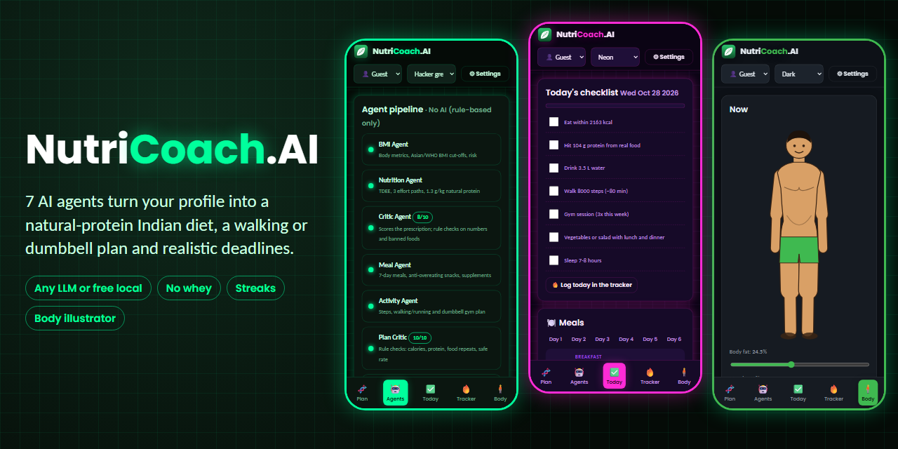
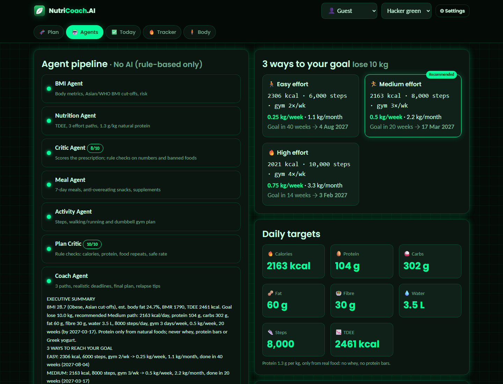
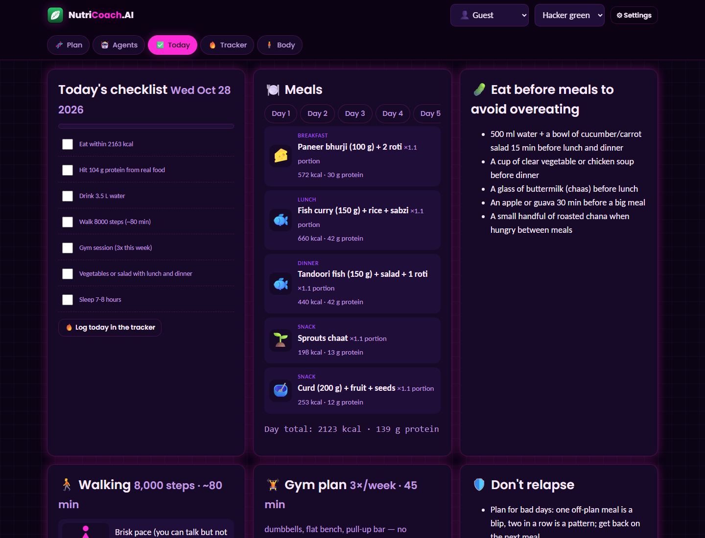
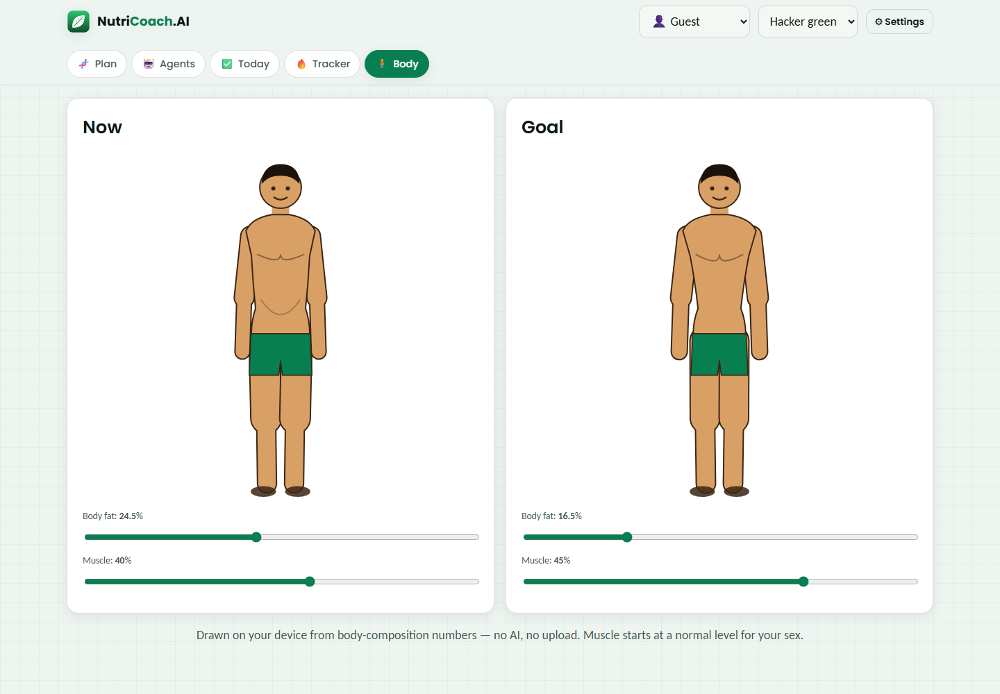
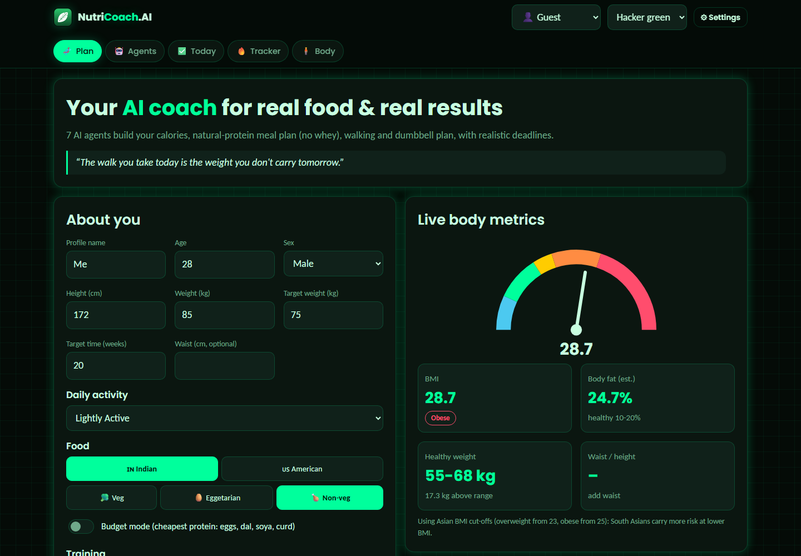
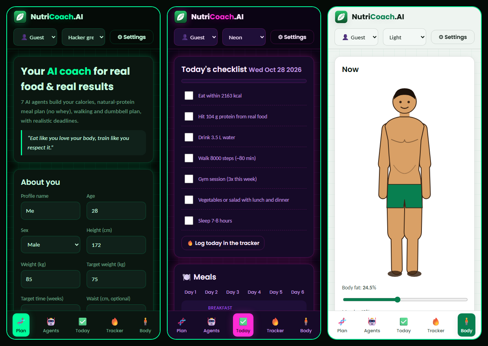

# NutriCoach.AI


**A multi-agent AI nutrition and fitness coach for real food and real results.** 7 LangGraph
ReAct agents turn your profile into calorie targets, a natural-protein Indian (or American) meal
plan, a walking or minimal-equipment gym plan and **realistic deadlines**. Daily tracking,
streaks and a local body illustrator keep you going.



- **Works with any LLM.** OpenAI, Claude, Gemini, DeepSeek or a **free local model via
  Ollama**. There is also a no-AI mode. Every number is computed in code and the model only
  writes the explanations, so even a 1-4 GB local model gives a correct plan.
- **Real food only.** Protein is 1.3 g/kg from eggs, chicken, fish, paneer, tofu, dal, curd,
  milk, soya and nuts. **No whey, protein bars or Greek yogurt.** Budget mode uses only the
  cheapest sources.
- **Built for Indians**, at home or abroad, with Asian BMI cut-offs and Indian meals.
  American food is one click away.
- **Walking for everyone.** Gym users get a push/pull/legs plan using only **dumbbells, a
  bench and a pull-up bar**, plus bodyweight moves.

## Screenshots

| Agents + 3 effort paths | Today: checklist, meals, workouts |
|---|---|
|  |  |
| **Body illustrator (light theme)** | **Plan + live BMI gauge** |
|  |  |



## Features

| | |
|---|---|
| **3 ways to your goal** | Easy, Medium and High effort paths, each with calories, steps, gym days, kg/week, kg/month and a real deadline date. Unsafe targets are flagged (loss is capped at 1% of body weight a week). |
| **Daily plan** | A tickable checklist for food, protein, water, steps, gym and sleep. 7 days of meals with portions, and snacks to eat before meals so you don't overeat. |
| **Weight gain** | Lean-gain surplus, homemade high-protein shakes and calorie-dense Indian foods, with treats allowed twice a week. |
| **Activity** | Step targets with a 6-week ramp-up and easy runs on the High path. Gym users get PPL or full-body sessions with animated exercise diagrams. |
| **Supplements** | Bone health and recovery only: vitamin D3, calcium, magnesium, B12/omega-3 for vegetarians, optional creatine. |
| **Tracker** | Log calories eaten and steps. Each day is labelled a **fat loss, fat gain or maintenance day**. |
| **Gamified** | Walking, healthy-eating, calorie-budget and gym streaks (2+ sessions a week), XP levels from Rookie to Legend, motivation quotes. |
| **Body illustrator** | Cartoon "now" and "goal" bodies drawn on your device from body-fat % and muscle % sliders. No AI, no upload. |
| **Metrics** | BMI gauge (Asian or WHO cut-offs), obesity class, estimated body fat, waist-to-height ratio, healthy weight range, BMR and TDEE. |
| **Profiles** | Up to 3 saved profiles, each with its own plan and history. |
| **Themes** | Hacker green (default), light, dark and neon pink/purple. Responsive from 320 px phones to 4K, in portrait and landscape. |

## Agent graph

```
BMI Agent ─► Nutrition Agent ─► Critic ──(score < 7, max 2)──► Nutrition Agent
                                  │
                                  ▼
                 Meal + Supplement Agent ─► Activity Agent ─► Plan Critic ──(fails)──► Meal Agent
                                                                   │
                                                                   ▼
                                                              Coach Agent ─► END
```

| Agent | Tools | Model tier |
|---|---|---|
| BMI | `calculate_bmi`, `classify_risk` | small |
| Nutrition | `compute_tdee` (3 paths), `build_macro_targets` | small |
| Critic | `score_plan` + code checks (numbers stated, no banned foods) | large |
| Meal + Supplement | `build_meal_plan`, `get_supplement_stack` | small |
| Activity | `walking_plan`, `gym_plan` | small |
| Plan Critic | rule checks: calories, protein, food repeats, safe rate, movement | large |
| Coach | `safety_check`, `synthesise_report` | large |

**Why it works on weak models:** `planner.py` computes the whole plan first, and each agent's
prompt carries the exact numbers. If a model can't call tools, the bare model still writes the
text. If it fails or writes nothing, the planner's own text fills in. The critics then check the
text against the numbers and the banned-food list.

## Compared with popular apps

| | NutriCoach.AI | HealthifyMe | MyFitnessPal | Noom | Fitbod |
|---|---|---|---|---|---|
| Free, no account | ✅ | Freemium | Freemium | ❌ | ❌ |
| Runs offline with a local AI | ✅ | ❌ | ❌ | ❌ | ❌ |
| Indian meal plans | ✅ | ✅ | Partial | ❌ | ❌ |
| Natural protein only (no whey) | ✅ | ❌ | ❌ | ❌ | ❌ |
| Realistic deadline per effort level | ✅ | Partial | ❌ | Partial | ❌ |
| Dumbbell + bench gym plan | ✅ | Partial | ❌ | ❌ | ✅ |
| Streaks and levels | ✅ | ✅ | Partial | ✅ | Partial |
| Body-composition visual | ✅ | ❌ | ❌ | ❌ | ❌ |
| Data stays on your device | ✅ | ❌ | ❌ | ❌ | ❌ |

## Setup

```bash
python -m venv venv
venv\Scripts\pip install -r requirements.txt
venv\Scripts\python.exe app.py        # http://localhost:5000
```

Open **Settings** to pick a provider and paste a key, or choose **Local LLM (Ollama, free)**:

1. Install Ollama from [ollama.com](https://ollama.com/download).
2. Pull a model that fits your RAM. Settings lists them smallest first:

   | Model | Download | RAM |
   |---|---|---|
   | `qwen2.5:1.5b` | 1.0 GB | 4 GB |
   | `llama3.2:3b` | 2.0 GB | 8 GB |
   | `qwen2.5:7b` | 4.7 GB | 16 GB |

   ```bash
   ollama pull llama3.2:3b
   ```

Use a small model for the narrating agents and a larger one only for the critics and the coach.
Any newer model id can be typed in.

Keys, settings, profiles and your log are stored only in `~/.nutricoach/`, never in the repo.

### Desktop app (.exe)

```bash
venv\Scripts\python.exe desktop.py    # chromeless app window
build_exe.cmd                          # one-file NutriCoachAI.exe via PyInstaller
```

## Project structure

```
agents.py       7 ReAct agents, their tools, the LangGraph graph
planner.py      rule engine: metrics, paths, meals, activity, checks, fallback text
llm.py          provider layer (OpenAI, Anthropic, Gemini, DeepSeek, Ollama, offline)
tracker.py      profiles, daily log, streaks, levels, quotes (SQLite)
app.py          Flask API + SSE stream of the graph
desktop.py      desktop window launcher
templates/      single-page UI
static/css, js  themes, app logic, art.js (body illustrator + exercise diagrams)
docs/           screenshots and preview image
```

## Disclaimer

NutriCoach.AI is for education and general wellness. It is not medical advice. Talk to a doctor
or registered dietitian before changing your diet or starting supplements, especially if you
have a medical condition.

## License

MIT
